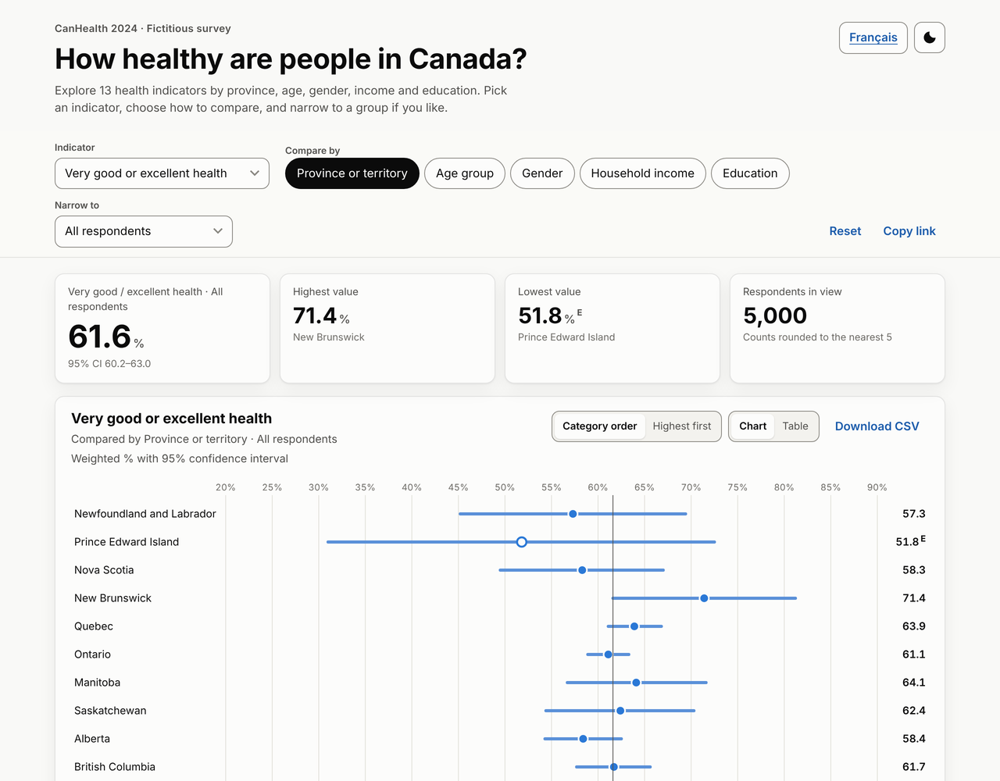
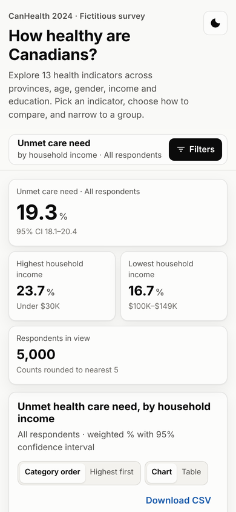
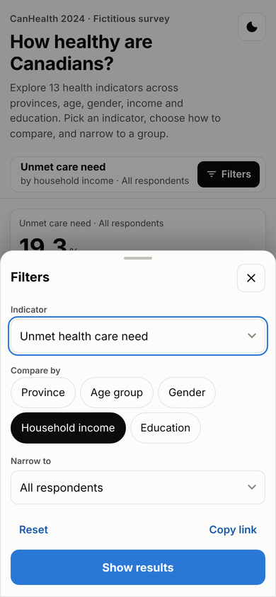
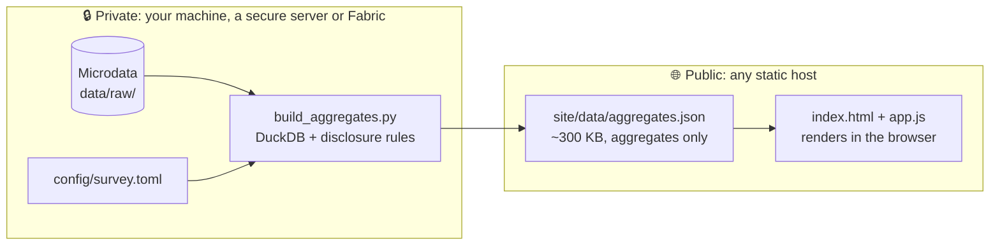
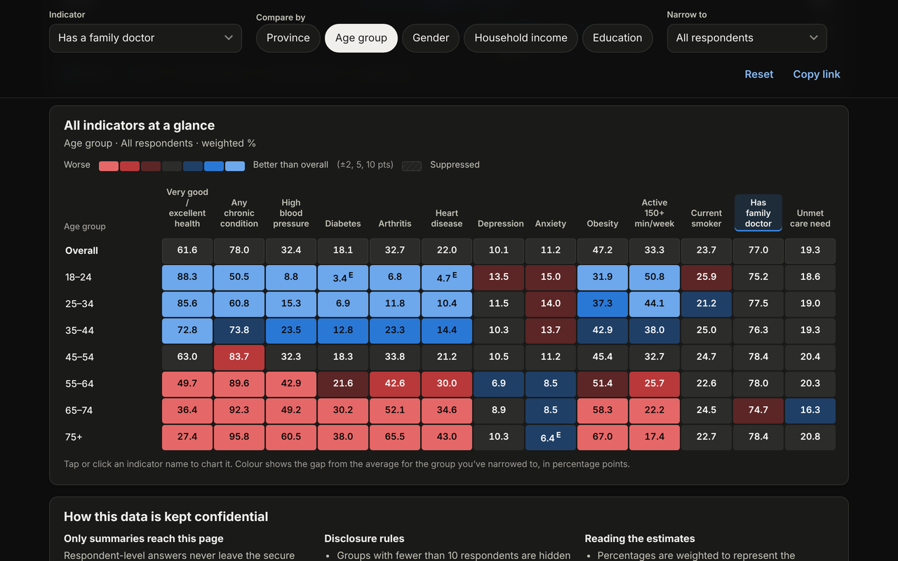

# Confidential Survey Dashboard

**Publish interactive survey results as a fast static website, without sending respondent data to the browser.**


<p align="center">
  
  
  
</p>

A private build step uses Python and DuckDB to turn respondent-level microdata into **one small JSON file of
disclosure-controlled aggregates**. A dependency-free web page then turns that file into an
interactive dashboard that works on phones and desktops.

- 🔒 **Confidential by design.** The browser only ever gets percentages, confidence intervals and rounded counts. Small groups are suppressed automatically, and the tests fail if anything unsafe gets through.
- 📱 **Built for phones too.** Filters become a bottom sheet, tap targets are large, and nothing relies on hover.
- 🎛️ **The user is in control.** They pick the indicator, compare across groups, narrow to a group, switch to a table, and download or share the exact view.
- ⚙️ **One config file.** Indicators, groups, labels, wording and disclosure rules all live in [`config/survey.toml`](config/survey.toml).
- 🚀 **Hosting is just files.** Deploy to GitHub Pages, GitLab Pages, Azure Static Web Apps, S3 or any web server.

---

## Contents

- [Quick start (5 minutes)](#quick-start-5-minutes)
- [How it works](#how-it-works)
- [Repository layout](#repository-layout)
- [Using your own data](#using-your-own-data)
- [Everyday commands](#everyday-commands)
- [Further reading](#further-reading)

---

## Quick start (5 minutes)

**You need:** [Git](https://git-scm.com/downloads) and [uv](https://docs.astral.sh/uv/getting-started/installation/), the Python package manager.
uv installs the right Python for you, so you don't need Python already.

```bash
git clone https://github.com/birrchr/accessible_dashboards_demo.git
cd accessible_dashboards_demo

make all      # install → generate demo data → build aggregates → run safety checks
make serve    # open http://localhost:8000
```

<details>
<summary><b>No <code>make</code>? (Windows)</b></summary>

Run the same steps directly:

```powershell
uv sync
uv run python pipeline/generate_demo_data.py
uv run python pipeline/build_aggregates.py
uv run pytest
uv run python -m http.server 8000 --directory site
```
</details>

The demo uses **CanHealth 2024**, an invented health survey of 5,000 synthetic respondents. None of it is real.

---

## How it works



1. **Microdata stays private.** `data/raw/` is git-ignored, and the build step is the only thing that reads it.
2. **The build step aggregates and protects.** For every indicator × group × filter combination it calculates weighted percentages and 95% confidence intervals. It then applies [the disclosure rules](docs/DISCLOSURE.md): it suppresses small cells, adds complementary suppression, flags unreliable estimates, and rounds counts.
3. **Tests check the output.** `make test` re-derives the true counts and fails if a published cell breaks a rule.
4. **The site is plain files.** `site/` is HTML, CSS and JavaScript with no build step or framework. Filtering happens instantly in the browser on the pre-computed file.

<p align="center">
  
</p>

---

## Repository layout

```
├── config/
│   └── survey.toml              ← ✏️  START HERE: indicators, groups, wording, rules
├── data/raw/                    ← 🔒 microdata (git-ignored; never committed)
├── pipeline/
│   ├── build_aggregates.py      ← microdata → site/data/aggregates.json
│   └── generate_demo_data.py    ← makes the synthetic demo dataset
├── site/                        ← 🌐 the website: deploy this folder
│   ├── index.html               ← page structure
│   ├── styles.css               ← colours, fonts, layout (brand tokens at the top)
│   ├── app.js                   ← charts, filters, interactions
│   └── data/aggregates.json     ← the ONLY data the browser sees
├── tests/                       ← safety checks (run with `make test`)
├── docs/                        ← guides: customizing, disclosure, deploying
├── .github/workflows/           ← CI + GitHub Pages deployment
├── .gitlab-ci.yml               ← the same for GitLab
├── Makefile                     ← shortcuts: make all / aggregate / test / serve
└── pyproject.toml, uv.lock      ← Python dependencies (managed by uv)
```

---

## Using your own data

1. **Put your microdata somewhere private.** Use `data/raw/` or any path outside the repo. It must be Parquet, CSV or a Delta table, with one row per respondent.
2. **Edit [`config/survey.toml`](config/survey.toml):**
   - `[source]`: the file path, its format and your weight column.
   - `[[dimensions]]`: the groups users can compare and filter by.
   - `[[indicators]]`: what to measure. Each one is a yes/no SQL condition.
   - `[site]`: title, intro text and default view.
3. **Rebuild and check:** `make aggregate && make test`
4. **Preview:** `make serve`
5. **Publish:** commit `site/data/aggregates.json` (never the microdata) and push. See [docs/DEPLOYING.md](docs/DEPLOYING.md).

👉 **[docs/CUSTOMIZING.md](docs/CUSTOMIZING.md)** walks through every change with copy-paste examples, from "add an indicator" to "re-brand the colours".

---

## Everyday commands

| Command | What it does |
|---|---|
| `make setup` | Install or update Python dependencies into `.venv/` |
| `make demo-data` | Generate synthetic microdata (skip this with real data) |
| `make aggregate` | Rebuild `site/data/aggregates.json` from the config |
| `make test` | Run every safety and correctness check |
| `make serve` | Preview the site at http://localhost:8000 (`make serve PORT=9000` to change port) |
| `make all` | setup → demo-data → aggregate → test |

---

## Further reading

| Guide | Read it when you want to… |
|---|---|
| [docs/CUSTOMIZING.md](docs/CUSTOMIZING.md) | change indicators, groups, wording, colours or charts |
| [docs/DISCLOSURE.md](docs/DISCLOSURE.md) | understand or tune the confidentiality rules, and their limits |
| [docs/DEPLOYING.md](docs/DEPLOYING.md) | publish to GitHub Pages, GitLab Pages, Azure or elsewhere |

## Licence

[MIT](LICENSE). Use it, adapt it, ship it.
